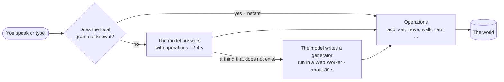
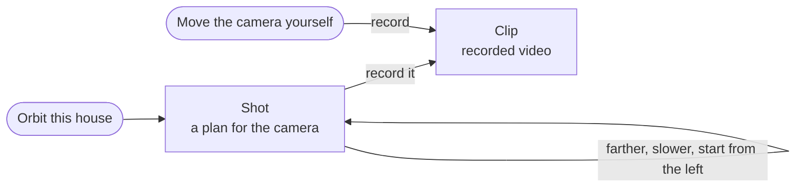

# Koemachi: how it is put together, and where to extend it

_Koemachi is built on [spoken-world](https://github.com/ryannli/spoken-world) by ryannli (Apache-2.0). This document keeps its structure and describes what this fork changed._

A sentence takes the shortest path that can carry it out:



Filming is the same idea in two steps: a shot is a plan, a clip is a recording.




One page, one local server. `app/` is the page; `site/build.mjs` copies it to `site/dist`, adds a script tag for every file in `app/generators/` and loads
`site/tinker.js` first; `site/serve.js` serves it and forwards the model calls to Tinker. Scripts load in the order below; each layer only knows the ones above it.

```
core.js      maths, colours, the parts builder (b.box, b.extrude, …), the renderer of parts
gens.js      the built-in object types of spoken-world (G.house, G.bus, …): each a recipe that builds an object from parameters and a seed
gens2.js     more of them
generators/  Koemachi's own object types, one file each (see app/generators/README.md); _common.js and _shop.js are shared helpers
world.js     the world: objects (W.objs), environment (W.env), motion, gravity, collision, aim, save/restore
floors.js    walkable surfaces that are not the ground (terraces, steps): YX.floorAt, and the height every object stands on (o.base)
ops.js       the operations every sentence compiles to ({op:'add'|'set'|'move'|…}), undo, invented object types (code in a worker)
stage.js     cameras, shots, camera moves
koemachi.js  the starting town: terraces, buildings, railway, shopping street, shrine, people (YX.buildTown); the noun index for the new generators
mind.js      speech -> operations: tier 0 local grammar (instant), tier 1 the AI streams operations, tier 2 the AI writes a new object type or a scene
host.js      where the page lives: who provides the AI, voice input and saving     <- swap this to move house
ui.js        boot, input, voice, panels, language
film.js      recording, playing a recorded clip back
inside.js director.js multicam.js talk.js play.js after.js grass.js post.js wet.js perf.js guide.js
             rooms, AI shot design, three cameras, the townspeople, playback, consequences, grass, grading, rain, frame-rate guard, first-run guide
lookfix.js   Look & Fix: a picture of a new object is shown to the model with the request; the fix rounds themselves are in mind.js (inventRun)
sessions.js  kept results (not failed, not undone within 30 s) written as chat examples to data/sessions.jsonl
sea.js railway.js seasons.js    the animated sea, the train and the level crossing, the four seasons (they chain YX.onFrame, so they load last)
ja.js        日本語: Japanese sentences rewritten into the English grammar's phrasing before the local rules see them
savegen.js   "Save as generator": an object the model wrote becomes a file in app/generators/
```

State is data, not meshes: an object is `{ id, type, params, x, y, z, rot, s, seed, motion, … }`; its shape is rebuilt from that by its
recipe. The whole world serialises to one JSON document (`YX.serialize()` / `YX.restore()`), which is what saving, undo and the film's
deterministic takes rest on.

## Extension points

| To add… | Do this | Nothing else changes because… |
|---|---|---|
| a built-in object | one entry `G.name = { label, nouns, params, build(b, p, rand) }` in gens2.js | nouns feed the grammar, the catalogue goes to the AI's prompt, params get sliders and sentences for free |
| an object at run time | nothing: "add a …" makes the AI write a recipe (`YX.registerCustom(meta, code)`), saved with the world | invented types go through the same builder and the same operations |
| a new kind of sentence | a rule in mind.js `parse…` that returns operations, or just a line in the operation catalogue the AI reads | every tier compiles to the same operations |
| a new operation | `OPS.name = (op, ctx) => ({ ok, msg })` in ops.js, plus one line in the catalogue in mind.js | undo, logging and the AI path wrap every operation the same way |
| a world rule as a setting (rain strength, wind, …) | as gravity is done: the value lives in `W.env` (world.js `setEnv`), `{op:"env","gravity":0}` sets it, a line of grammar says it ("zero gravity") | env is already saved, undone and described to the AI |
| another home (your own proxy, another model, another speech service) | one host object: `window.SW_HOST = { ai, voice, save, gate, strings }` before host.js (see app/js/host.js; site/tinker.js is the worked example) | the page only ever talks to `YX.host` |
| something that reacts to the world | a hook: `YX.hooks.afterCommand`, `YX.hooks.log`, `YX.hooks.ui`, `YX.onFrame` | talk.js, after.js and guide.js are all built this way |

## The home, and what Koemachi added

- **Home**: `node site/serve.js` serves the page and, at `POST /__tinker/messages`, forwards the page's model calls to Tinker's Anthropic-compatible Messages
  API with the key from `.env` (the key never reaches the browser). `site/tinker.js` is the host: the AI (Inkling), voice (the browser's Web Speech API) and saving files.
  The server also keeps Look & Fix pictures (`/__shot`), kept examples (`/__session`) and saved generators (`/__generator`) under `data/` and `app/generators/`.
- **A hillside in an engine with no terrain**: the ground is flat and almost everything assumes y = 0 is the floor, so the slope is a stack of `terrace` objects with
  stone `steps` between them. A generator with a `floor(p, lx, lz)` function is a floor; every other object keeps its `y` relative to the floor under it and the engine adds
  `o.base` when it draws it (world.js `syncHolder`), so gravity, placement, people and vehicles work on a terrace as on the ground. The player follows `YX.floorAt`, and a
  terrace edge higher than a step is a wall. A floor can only stand on floors made before it (steps on a terrace, never the reverse).
- **Seasons** are one value, `W.env.season`, saved and undone like the weather. seasons.js notices a change and, over about two seconds, rebuilds the trees (and, in or out of
  winter, the roofs and terraces) with the old look dissolving over the new (`YX.dissolve`), tweens the ground colour, fades falling petals, leaves or snow in and out, and puts up
  or takes down the summer festival lanterns. Generators read `YX.koe.season` when they are built.
- **Japanese** (ja.js) is a translation layer in front of the English grammar, not a third parser: a Japanese clause is matched by a rule for its kind (season, time, weather, add,
  remove, resize, colour, move, undo, camera, people) and rewritten as the English command; what it does not recognise goes to the model as it is.

## What is deliberately not here yet

- Real physics (stacking, toppling, collisions with response): motion and gravity are hand-written rules. A physics engine would sit beside world.js `gravity()`/`solidPush()`.
- NPC memory beyond the last 8 exchanges per person, and people talking to each other (talk.js).
- Sharing a world between viewers (the world is one JSON document, so a host with storage could provide it: a `store` member on the host).


## Film: how a shot is made, changed and recorded

1. **Ask for a move** ("orbit this house", "push from the corner to the bakery door, then rise"). `director.js` gives the model the request, the camera, the subject (with the distance needed to hold all of it in frame at 24/35/50 mm), every obstacle's footprint and height, the roads and who is moving. The answer is 3-7 keyframes; the engine smooths them, bends the path round or over anything solid, flies it once as a preview and keeps it as a shot.
2. **Say what to change.** The shot is remembered as its keyframes (`director.last`), so a note changes that shot instead of asking for a new one:
   - distance, height, speed, direction and lens ("farther", "too low", "slower", "the other way", "wider lens", "20 m away") are arithmetic on the keys (`applyNote`): instant and exact, no model call;
   - anything else ("start from the left and end on the door") goes to the model together with the shot as it stands and the notes already given, with the instruction to change only what the note is about.
   A note counts as being about the shot when it names the camera or follows a shot directly; "higher" said after other work is still about the object under the crosshair. The buttons under the plan do the same things.
3. **"Record it"** flies the shot again and films it, and stops by itself. "Action" / "cut" are only for filming by hand and for standing cameras.

Standing cameras (`multicam.js`): "film this with three cameras" places three around the subject (`angles`: three of wide, side, low, close, front, back, top). "Put a camera here" stands one where the player is, filming exactly what they see; up to three, anywhere, including indoors (`YX.eyes` keeps that room built and lit). "Action" films them side by side in one clip, one 1280x720 picture each.

People use doors (`ops.js` walk, `world.js` goto): a walker's `ms.via` is a stretch walked exactly as laid out, with the height following the floor. Going into a building is door -> floor -> spot; coming out is floor -> door -> ground. `{"op":"walk","from":BUILDING}` brings out whoever is inside, or a new person when nobody is.


## Freedom before presets

Where a thing could be done in many ways, the engine takes a description, not a pick from a list; the named presets are shorthand for the same numbers.

- **Paths** (`director.js` route, `world.js` motion `route`): anything that flies, walks or drives can be given a path in words ("a figure of eight over the square", "spiral up the tower and land on its roof"). The model gets the same plan of the place as for camera work and writes the points; the engine smooths them, takes them round (or over) what is in the way, and the thing travels them once or round and round. A path that ends on a roof is a landing. Notes change the path the way they change a shot. `flight: circle | roam` remain as two instant presets.
- **Standing cameras** (`multicam.js`): `cams: [{az, dist, height, lens, look, travel}]` describes each camera round its subject, whether the subject stands or moves; `angles: ["wide", "close", ...]` are named sets of those numbers. `here` puts one where the player stands; `follow` makes it turn with something.
- **Pointing** (`world.js` updateAim): boxes only choose which things to ask; the line of sight is tested against their real surfaces. When it meets only ground or a hillside, lines a little to each side are tried, because the crosshair has a size: the gap between a rover's legs is the rover.
- **Doors**: a door leaf is a `hinge` part; `YX.holdDoor(building, seconds)` opens it for whoever walks through, the player included. A house is a shell with a real doorway, so the room shows through it.

The open-web build stamps itself (`window.SW_BUILD`, `version.json`): an open tab notices a newer build on the server and offers to reload.
