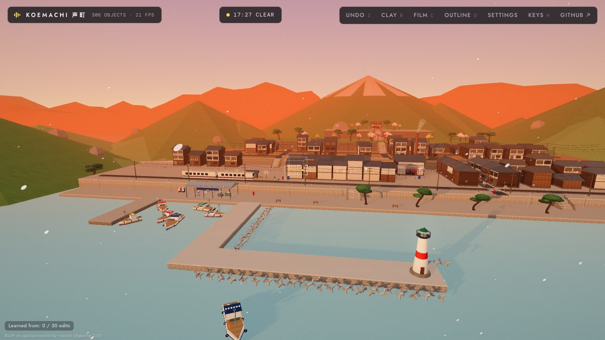
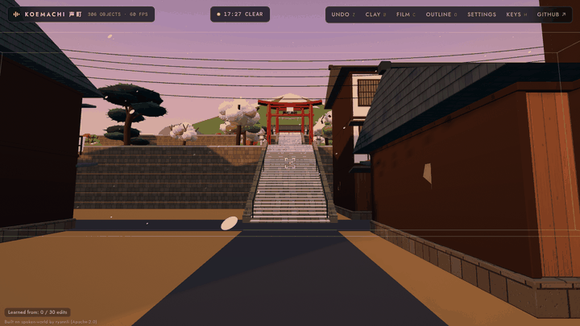

<h1 align="center">Koemachi · 声町</h1>

<p align="center"><b>Say it, and the town changes.</b><br>
An original Japanese seaside hill town you shape by talking to it, in your browser, on Thinking Machines' Inkling.</p>

<p align="center"></p>

> **Koemachi is a modified version of [Spoken World](https://github.com/ryannli/spoken-world) by ryannli (Apache-2.0), made by [lauralin-lab](https://github.com/lauralin-lab). It is not the original and is not endorsed by its author.** It runs on Thinking Machines' Inkling through Tinker. It adds *Look & Fix*,
> *Train my world* (a LoRA trained on the edits you kept) and *Watch it learn* (the base model and each checkpoint side by side). See [NOTICE](NOTICE) for what changed.

**A fictional town, built entirely from code.** Koemachi sits on a slope between the sea and a wooded hill: a small fishing harbour with a breakwater and a lighthouse, a single-track
railway with a level crossing and a tiny unstaffed station (a one- or two-car train passes every minute, and the crossing lamps flash and the barrier comes down), a covered shopping street
(*shotengai*) with a ramen shop, a sweets shop, a general store and a bathhouse with a tall chimney, lanes four metres wide between wooden houses with tiled roofs and laundry on the balconies,
and stone steps lined with cherry and maple trees up to a red torii and a small shrine with a view of the sea. Every house, boat, tree and person is made by code: no model files, no textures to
download. Drawn with Three.js and nothing else.

**Speak, and it is so.** Walk in, point at something, hold Space and say what you want: *"make it autumn"*, *"put a vending machine here"*, *"make this house taller"*, *"let it snow"*.
Say something that does not exist yet, *"put a ramen food truck here, with steam"*, and the model writes it while you wait. In English, 中文 or 日本語.

<p align="center"></p>

## Run it

Needs Node 18 or later, Chrome, and a Tinker API key. There is nothing to install.

```sh
git clone https://github.com/lauralin-lab/koemachi && cd koemachi
cp .env.example .env              # then put your Tinker base URL and key in it
node site/build.mjs
node site/serve.js                # http://localhost:8080   (PORT=8090 node site/serve.js for another port)
```

`.env` is git-ignored. The page sends its model calls to the local server (`/__tinker/messages`), which adds the key and forwards them to Tinker's Anthropic-compatible Messages API, so the
key never reaches the browser ([how it is handled](SECURITY.md)). Voice is the browser's own Web Speech API (Chrome): hold **Space** to talk, press `/` to type.
The **日本語 / English** button beside the input bar chooses the language you speak (中文 is in Settings). Each model call's latency and token counts are in `SW_HOST.usage` (browser console).

## What to say

| | English | 中文 | 日本語 |
|---|---|---|---|
| season | make it spring / summer / autumn / winter | 变成春天 / 夏天 / 秋天 / 冬天 | 春にして · 夏にして · 秋にして · 冬にして |
| weather | let it snow · make it rain · clear sky | 下雪吧 · 下雨 · 放晴 | 雪を降らせて · 雨にして · 晴れにして |
| time | make it morning / noon / golden hour / night | 变成早上 / 中午 / 黄昏 / 夜晚 | 朝にして · 昼にして · 夕焼けにして · 夜にして |
| add | put a vending machine here · three cherry trees | 在这里放一台自动贩卖机 | ここに自動販売機を置いて · 3本の桜を植えて |
| change | make this house taller · make it red | 把这个房子变高一点 | この家をもっと高くして · これを赤くして |
| remove, undo | remove it · undo | 删掉它 · 撤销 | これを消して · 元に戻して |
| film | orbit this house · record it | 环绕这个房子拍一圈 | この家の周りを一周して撮って · 録画して |
| keep | save this as a generator | 保存为生成器 | ジェネレーターとして保存して |

**With the Tinker features** (the buttons are in the bottom-left corner; see [The Tinker features](#the-tinker-features)):

| | What to do |
|---|---|
| Look & Fix | say something that makes a *new kind* of object, e.g. *build a ramen food truck here*, *a stone tanuki statue by the shrine*, 在这里造一辆拉面小摊车, ここにラーメンの屋台を作って. Then watch the corner note: *Checking… / Fixing… / Fixed: …* |
| Undo a build | *undo* (or **Z**) once removes the whole generated object, including its Look & Fix revisions, and stops a build in progress. An undone result is not kept for training |
| Train my world | keep making things you like (the corner counter shows *Learned from: N / 30 edits*), then press **Train my world**, wait for the epochs, press **Use** on a checkpoint. Now the same sentences go to *your* model. **Use base model** switches back |
| Watch it learn | type a sentence in the Train panel (e.g. *put three cherry trees here*), press **Watch it learn**, walk along the street to compare *Base*, *Epoch 1*, *Epoch 2*… side by side |
| Replay it | press **● Replay it**, hold **Space** and say a sentence (*🎙 listening…* and your words are written on the film), watch it build (as long as it takes), press **Esc** when you want to stop, and the camera takes one lap |

Sentences the built-in grammar knows run instantly and cost nothing; anything else goes to the model (about 2–10 s), and a new kind of object takes about a minute.

## The Tinker features

Press **✦ Tinker features** (bottom left): it lists Look & Fix, Train my world, Watch it learn and Replay it, whether each is on, and how to start it. Look & Fix can be switched off there.

- **Look & Fix** (built). After the model builds a *new kind* of object, the page renders it alone from a temporary camera, shows the picture to the model together with your request, and if the model names a
  problem ("wheels were floating") revises the code and rebuilds it, with the old look dissolving over the new, up to two rounds. It runs in the background: you see the object at once, a small
  note in the corner says *Checking… / Fixing… / Fixed: … / Looks right*, and after a command that wrote nothing new it says *not needed* so you can tell it did not run, and the before and after pictures of every fix are kept in `data/lookfix/`. Thinking effort is set per kind of
  call in `site/tinker.js`; everything runs at `low`, which was the fastest setting that gave correct results in testing.
- **Train my world** (built). Every model result you keep (it did not fail and you did not undo it within 30 seconds) is written as a chat example to `data/sessions.jsonl`; the corner counter
  shows *Learned from: N / 30 edits*. From 30 edits, the **Train my world** button (bottom left) trains a LoRA (rank 16, 3 epochs) on thinkingmachines/Inkling-2-Small with `train/train.py`,
  started by the local server (needs [uv](https://docs.astral.sh/uv/) and the same `TINKER_API_KEY`). The panel shows progress and loss; every epoch saves a checkpoint to `data/models.json`.
  **Use** on a checkpoint switches the town to it (the server sends its model calls to that `tinker://…/sampler_weights/…` path through the same Messages API); **Use base model** switches back.
  Training uses your Tinker account and is billed there. `SW_MIN_TRAIN=10` lowers the 30-edit threshold.
- **Watch it learn** (built). In the same panel, type a sentence (it starts with your last command) and press **Watch it learn**: the base model and each checkpoint of the newest training run get
  the very same prompt, and each answer is built in its own lane, 13 m apart to your right and 8 m ahead, with a name above it (*Base*, *Epoch 1*, *Epoch 2*…). Walk along the street to compare.
  Only operations that make something new (add, scatter, row, crowd) are built; anything that would change what already stands, or take a long build (invent, plan), is listed in the panel as text
  instead, so a comparison never changes your town. **Clear lanes** removes it all. Each model is asked once, so a comparison of four costs four calls.

- **Replay it** (built). The **● Replay it** button (bottom left) films the whole story of a request: every frame of the 3D view is drawn together with what Tinker is doing (the model in use,
  your sentence, *Inkling · working…*, Look & Fix's *Checking… / Fixing…*, and the names above the lanes of Watch it learn), and recorded at 1280×720 with your microphone if you allow it (it is open only while you hold Space or the 🎙 button, so the room around you is not recorded), mixed with the town's own sounds. When Look & Fix looks at a new object, the picture it shows the model appears on the film with a scan line, and then its verdict (a talking townsperson's synthesized speech is the one sound the browser does not let a page record). There is no time limit: it keeps filming through the long builds and the pauses until
  you press **Esc** or the button, then the camera takes one lap around the result and the clip opens like any other (the ordinary film tools stop at 10 s). Everything stays on your computer; the clip is saved by your browser.

## Add your own generators

Every object type is one file in [`app/generators/`](app/generators/README.md): a header comment and a `build(b, p, rand)` function. When the model builds something you like, press
**Save as generator** (or say "save this as a generator") and the code it wrote is saved there in the same format, ready to review and contribute back. How to write one by hand, the fields, the builder
and the checks are in [app/generators/README.md](app/generators/README.md).

## For developers

How it works inside is in [ARCHITECTURE.md](ARCHITECTURE.md).

```sh
node tests/check_generators.js                       # every generator: header, fields, and that build() runs (no browser)
cd tests && npm install && npx playwright install chromium
node run.js                # all the scenarios, through the real server and the Tinker host, with a stand-in model (no key, nothing billed)
node run.js koemachi1 seasons1 ja1     # some
```

Each scenario prints what happened; the Koemachi ones (`koemachi1`, `seasons1`, `ja1`, `lookfix1`, `session1`, `generators1`) throw when a check fails. The older engine scenarios
run in the original spoken-world town, kept in `tests/fixtures/` for that purpose only.

## Known limits

- Desktop Chrome with a keyboard and mouse. Voice needs Chrome's speech service (the audio goes to Google, not to this app or to Tinker).
- The hillside is built from stepped terraces and stone steps: the engine has no terrain. Houses are not enterable (the original spoken-world houses are, and still can be added by voice).
- One clip is at most 10 seconds. The world is saved in the browser's local storage: one world per browser, no accounts, no sharing.
- Japanese is understood by rewriting it into the English grammar; messages and the log stay in English or Chinese.
- Japanese text on signs is drawn with the system's fonts (Noto Sans JP if it is installed).
- The frame rate was measured only in a software renderer; on a laptop GPU it should be much higher. A start view is about 600,000 triangles.

## Built on spoken-world

Koemachi is a fork of **[spoken-world](https://github.com/ryannli/spoken-world) by ryannli** (Apache-2.0), which provides the engine: the object builder, the instant grammar, the
three-tier mind, the film tools and most of the page. This fork replaces the model provider, the town, the language and a good part of the generators; what changed is listed in [NOTICE](NOTICE).
Thank you, ryannli.

## License

Code: [Apache-2.0](LICENSE). Third-party parts and fonts: see [NOTICE](NOTICE).
