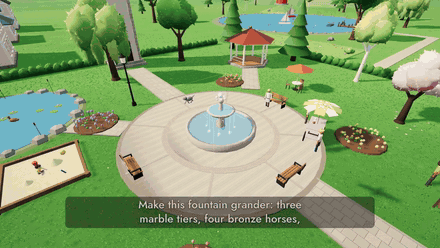
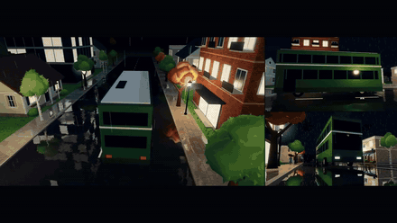
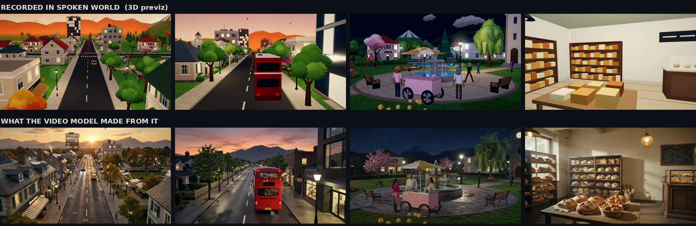

<h1 align="center">Spoken World</h1>

<p align="center"><b>Say it, and the world changes.</b><br>
A real-time 3D world you shape by talking to it, running in your browser.</p>

<p align="center">
  <a href="https://spoken-world.vercel.app"><b>Try it</b></a> &nbsp;·&nbsp;
  <a href="#ways-to-run-it">Run it yourself</a> &nbsp;·&nbsp;
  <a href="#cost">Cost</a>
</p>

<p align="center"></p>

<p align="center"><sub>"Make this house taller." &nbsp;·&nbsp; "Add many trees here." &nbsp;·&nbsp; "Add a pond here." &nbsp;·&nbsp; "Add ten houses here." &nbsp;·&nbsp; "Make it a rainy night."</sub></p>

**You speak, and it is so.** Point at something, hold Space and say what you want. "Make this house taller."
"Put a café across the street." "Make it a rainy night." "Add a sleepy boar." The world changes in front of you, while
you are still standing in it. People who live there can be clicked and spoken with.

**An open world with no end, and a film set.** Wander and keep building: there is no list of things you are allowed to
ask for, so the game never runs out. Or direct it: "orbit this house… farther… record it", put three cameras on a bus,
have someone walk out of a door, then turn the clip you recorded into live-action footage.

**All of it generated, all of it in the browser.** Every house, tree, bus and person is made by code, and anything that
does not exist yet is written by a language model while you wait. It is drawn with Three.js and nothing else: no game
engine, no model files, no install. Open a page and talk.

<table>
  <tr>
    <td width="33%" align="center" valign="top">
      <br>
      <b>Say it</b><br>
      <sub>"Make it a double-decker."</sub>
    </td>
    <td width="33%" align="center" valign="top">
      <br>
      <b>Ask for what does not exist</b><br>
      <sub>"Make this fountain grander: three marble tiers, four bronze horses, and a ring of jets."</sub>
    </td>
    <td width="33%" align="center" valign="top">
      <br>
      <b>Film it, then make it real</b><br>
      <sub>"Film the bus with three cameras… now turn them into reality."</sub>
    </td>
  </tr>
</table>

<p align="center"><sub>Cut from a film recorded in the real interface. Captions were added in the edit; where the model's wait is shortened, the corner of the picture says so; the last clip ends in footage a video model made from the recording.</sub></p>

## From a 3D sketch to footage

<p align="center"></p>

Top row: frames of clips recorded in the world. Bottom row: the same moment of the footage a video model made from each
clip, keeping the camera move and where everything stands. The page comes with these pairs to play side by side.

## Ways to run it

It needs a model to do any of this, so there is no mode without one: either you give the page a Gemini API key, or you
run it as a Claude artifact on your own Claude account.

### 1. The hosted page, with your Gemini key

Open https://spoken-world.vercel.app and paste a key from https://aistudio.google.com/apikey.
The key stays in your browser and goes only to Google's Gemini API ([how the key is handled](SECURITY.md)).

### 2. On your own computer

Needs Node 18 or later. No dependencies to install.

```sh
git clone https://github.com/ryannli/spoken-world && cd spoken-world
node site/build.mjs
node site/serve.js          # http://localhost:8080
```

To skip typing the key, put it in a file the local server reads (it is handed only to the page on localhost,
kept in memory, never printed):

```sh
echo 'GEMINI_API_KEY=your-key' > .env      # .env is git-ignored
```

`GEMINI_API_KEY` in the environment, or `SW_ENV_FILE=/path/to/file`, work too.

### 3. Your own deployment

Import the repository into Vercel and press Deploy: `vercel.json` already says how to build
(`node site/build.mjs`, output `site/dist`). Any static host works the same way; the microphone needs HTTPS
and the `Permissions-Policy: microphone=(self)` header.

### 4. As a Claude artifact

`app/` on its own is a complete page that takes its model, speech-to-text and file saving from the Claude
artifact runtime (`window.claude.use(...)`, wrapped in `app/js/host.js`). Published as an artifact from
Claude, it needs no API key: each viewer uses their own Claude account. The video model is not available
there, so "Make it real" exports the clip for you to take elsewhere.

## Cost

The page calls Gemini with your key, so Google bills you. Measured in November 2026 with the models set in
`site/gemini.js`; prices change, so treat these as orders of magnitude:

| What you do | Model | About |
| --- | --- | --- |
| A command the local grammar understands (most edits, moves, camera notes) | none | free, instant |
| A command that needs the model | Gemini 4 Hydrogen | $0.01, 2-4 s |
| A person answering you | Gemini 4 Hydrogen | under $0.01 |
| A new kind of object written for you | Gemini 4 Hydrogen | $0.07, about 30 s |
| A whole place planned ("build a harbor") | Gemini 4 Hydrogen | $0.15 |
| Voice input | Gemini 3.5 Transcribe Live | about $0.01 a minute |
| "Make it real" on a clip | Gemini Omni | about $0.10 per second of video; no free tier |

"Make it real" runs only when you press it. The page shows what each call used in `SW_HOST.usage` (browser console).

## For developers

How it works inside is written up in [ARCHITECTURE.md](ARCHITECTURE.md).

Scenario scripts that run inside the page under Playwright, with a stand-in for the model (no key, nothing billed):

```sh
cd tests && npm install && npx playwright install chromium
node run.js                # all of them
node run.js aim2 route1    # some
```

Each prints what happened; they are read, not asserted. See the top of `tests/run.js`.

## Known limits

- Desktop browsers with a keyboard and mouse; Chrome is the one it is tested in.
- One clip is at most 10 seconds.
- Paths written for cars avoid buildings but do not follow roads.
- Only houses, shops and cafés have doors that open.
- People are simple figures.
- The world is saved in the browser's local storage: one world per browser, no accounts, no sharing.
- The scene description sent to the video model is written by rule from the world, not by a model; you can edit it before sending.

## License

Code: [Apache-2.0](LICENSE). Third-party parts and the example clips: see [NOTICE](NOTICE).
