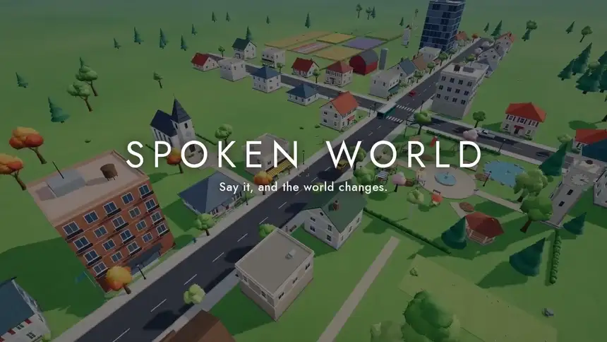
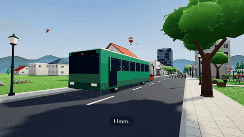

<h1 align="center">Spoken World</h1>

<p align="center"><b>Say it, and the world changes.</b><br>
A real-time 3D world you shape by talking to it, running in your browser.</p>

<p align="center">
  <a href="#run-it"><b>Run it</b></a> &nbsp;·&nbsp;
  <a href="#for-developers">For developers</a>
</p>

<p align="center"></p>

<p align="center"><sub>"Make this house taller." &nbsp;·&nbsp; "Add many trees here." &nbsp;·&nbsp; "Add a pond here." &nbsp;·&nbsp; "Add ten houses here." &nbsp;·&nbsp; "Make it a rainy night."</sub></p>

**You speak, and it is so.** Point at something, hold Space and say what you want. "Make this house taller."
"Put a café across the street." "Make it a rainy night." "Add a sleepy boar." The world changes in front of you, while
you are still standing in it. People who live there can be clicked and spoken with.

**An open world with no end, and a film set.** Wander and keep building: there is no list of things you are allowed to
ask for, so the game never runs out. Or direct it: "orbit this house… farther… record it", put three cameras on a bus,
have someone walk out of a door, and record the clip.

**All of it generated, all of it in the browser.** Every house, tree, bus and person is made by code, and anything that
does not exist yet is written by a language model while you wait. It is drawn with Three.js and nothing else: no game
engine, no model files, no install. Open a page and talk.

<table>
  <tr>
    <td width="50%" align="center" valign="top">
      <br>
      <b>Say it</b><br>
      <sub>"Make it a double-decker."</sub>
    </td>
    <td width="50%" align="center" valign="top">
      <br>
      <b>Ask for what does not exist</b><br>
      <sub>"Make this fountain grander: three marble tiers, four bronze horses, and a ring of jets."</sub>
    </td>
  </tr>
</table>

<p align="center"><sub>Cut from a film recorded in the real interface. Captions were added in the edit; where the model's wait is shortened, the corner of the picture says so.</sub></p>

## Run it

This fork is **Tinker-only**: the model is Thinking Machines' Inkling, reached through Tinker's Anthropic-compatible Messages API by a small
local server. Voice input is your browser's own Web Speech API (Chrome). There is nothing else to sign up for.

Needs Node 18 or later and Chrome. No dependencies to install.

```sh
git clone https://github.com/ryannli/spoken-world && cd spoken-world    # or your fork
cat > .env <<'ENVEND'
TINKER_BASE_URL=https://tinker.thinkingmachines.dev/services/tinker-prod/anthropic/api
TINKER_API_KEY=your-tinker-key
TINKER_MODEL=thinkingmachines/Inkling-2-Small
ENVEND
node site/build.mjs
node site/serve.js          # http://localhost:8080
```

`.env` is git-ignored. `TINKER_*` in the environment, or `SW_ENV_FILE=/path/to/file`, work too. `TINKER_MODEL` is optional.
The page sends its model calls to the local server (`/__tinker/messages`), which adds the key, so the key never reaches the browser
([how it is handled](SECURITY.md)). Hold Space to talk; press `/` to type instead.
Each model call's latency and token counts are in `SW_HOST.usage` (browser console).

## For developers

How it works inside is written up in [ARCHITECTURE.md](ARCHITECTURE.md).

Scenario scripts that run inside the page under Playwright, through the real local server and the Tinker host, with a stand-in for the model (no key, nothing billed):

```sh
cd tests && npm install && npx playwright install chromium
node run.js                # all of them
node run.js aim2 route1    # some
```

Each prints what happened; they are read, not asserted. See the top of `tests/run.js`.

## Known limits

- Desktop browsers with a keyboard and mouse; Chrome is the one it is tested in.
- One clip is at most 10 seconds.
- Paths written for cars avoid buildings but do not follow roads.
- Only houses, shops and cafés have doors that open.
- People are simple figures.
- The world is saved in the browser's local storage: one world per browser, no accounts, no sharing.
- The scene description sent to the video model is written by rule from the world, not by a model; you can edit it before sending.

## Credit

Built on [spoken-world](https://github.com/ryannli/spoken-world) by ryannli (Apache-2.0). What this fork changed is listed in [NOTICE](NOTICE).

## License

Code: [Apache-2.0](LICENSE). Third-party parts and the example clips: see [NOTICE](NOTICE).
