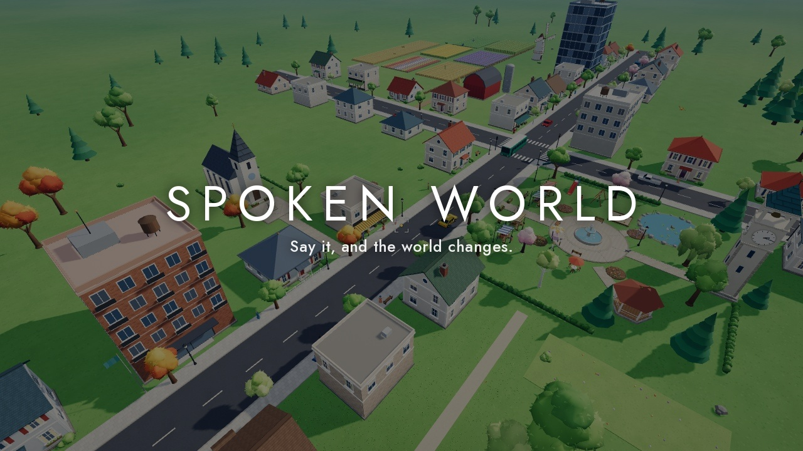

# Spoken World

A real-time 3D world you change by talking to it.

Point at something, hold Space and say what you want: "make this house taller", "put a café across the street",
"a person walks out of this house", "orbit this house… farther… record it". It happens in front of you.
Things that are not in the catalog are written on the spot by the model ("add a sleepy boar"). People in the
world can be clicked and spoken with. Shots can be directed by voice, recorded, and turned into
live-action footage by a video model.



| Say it | Ask for something that does not exist | Film it, then make it real |
| --- | --- | --- |
|  |  |  |
| "Make it a double-decker." | "Make this fountain grander: three marble tiers, four bronze horses, and a ring of jets." The model writes the new fountain; the wait is shortened here and labelled in the corner. | "Film the bus with three cameras… now turn them into reality." The second half is footage a video model made from the recorded clip. |

These are cut from a film recorded in the real interface. The captions were added in the edit.

**Try it:** https://spoken-world.vercel.app (you bring your own Gemini API key; see [Cost](#cost))

> Everything interesting here is done by a model, so there is no mode without one. Either you give the page
> a Gemini API key, or you run it as a Claude artifact on your own Claude account.

## Ways to run it

### 1. The hosted page, with your Gemini key

Open https://spoken-world.vercel.app and paste a key from https://aistudio.google.com/apikey.
The key stays in your browser and goes only to Google's Gemini API ([how the key is handled](SECURITY.md)).

### 2. On your own computer

Needs Node 18 or later. No dependencies to install.

```sh
git clone https://github.com/ryannli/spoken-world && cd spoken-world
node site/build.mjs
node site/serve.js          # http://localhost:8080
```

To skip typing the key, put it in a file the local server reads (it is handed only to the page on localhost,
kept in memory, never printed):

```sh
echo 'GEMINI_API_KEY=your-key' > .env      # .env is git-ignored
```

`GEMINI_API_KEY` in the environment, or `SW_ENV_FILE=/path/to/file`, work too.

### 3. Your own deployment

Import the repository into Vercel and press Deploy: `vercel.json` already says how to build
(`node site/build.mjs`, output `site/dist`). Any static host works the same way; the microphone needs HTTPS
and the `Permissions-Policy: microphone=(self)` header.

### 4. As a Claude artifact

`app/` on its own is a complete page that takes its model, speech-to-text and file saving from the Claude
artifact runtime (`window.claude.use(...)`, wrapped in `app/js/host.js`). Published as an artifact from
Claude, it needs no API key: each viewer uses their own Claude account. The video model is not available
there, so "Make it real" exports the clip for you to take elsewhere.

## Cost

The page calls Gemini with your key, so Google bills you. Measured in November 2026 with the models set in
`site/gemini.js`; prices change, so treat these as orders of magnitude:

| What you do | Model | About |
| --- | --- | --- |
| A command the local grammar understands (most edits, moves, camera notes) | none | free, instant |
| A command that needs the model | Gemini 4 Hydrogen | $0.01, 2-4 s |
| A person answering you | Gemini 4 Hydrogen | under $0.01 |
| A new kind of object written for you | Gemini 4 Hydrogen | $0.07, about 30 s |
| A whole place planned ("build a harbor") | Gemini 4 Hydrogen | $0.15 |
| Voice input | Gemini 3.5 Transcribe Live | about $0.01 a minute |
| "Make it real" on a clip | Gemini Omni | about $0.10 per second of video; no free tier |

"Make it real" runs only when you press it. The page shows what each call used in `SW_HOST.usage` (browser console).

## How it is built

Plain JavaScript modules and one HTML file; Three.js r128 from a CDN; no framework, no bundler.
[ARCHITECTURE.md](ARCHITECTURE.md) walks through the layers. In short:

- `app/js/core.js`, `world.js`: parts, materials, objects, motion, pointing, saving.
- `gens.js`, `gens2.js`: the catalog, each kind of thing as a procedural generator.
- `mind.js`: a sentence becomes operations. Tier 0 is a local grammar (instant); tier 1 a model answering with operations; tier 2 writes new generators and plans whole places.
- `ops.js`: the operations (`add`, `set`, `move`, `walk`, `route`, `invent`, ...).
- `director.js`, `multicam.js`, `film.js`: camera moves designed for the place, standing cameras, recording, the 3D-to-real comparison.
- `host.js`: where the model, the voice and the video come from. `site/gemini.js` is the Gemini host; the Claude artifact host is built in. A third host is one file.

`site/build.mjs` copies `app/` to `site/dist` and loads the Gemini host first. That is the only difference between the two builds.

## Tests

Scenario scripts that run inside the page under Playwright, with a stand-in for the model (no key, nothing billed):

```sh
cd tests && npm install && npx playwright install chromium
node run.js                # all of them
node run.js aim2 route1    # some
```

Each prints what happened; they are read, not asserted. See the top of `tests/run.js`.

## Known limits

- Desktop browsers with a keyboard and mouse; Chrome is the one it is tested in.
- One clip is at most 10 seconds.
- Paths written for cars avoid buildings but do not follow roads.
- Only houses, shops and cafés have doors that open.
- People are simple figures.
- The world is saved in the browser's local storage: one world per browser, no accounts, no sharing.
- The scene description sent to the video model is written by rule from the world, not by a model; you can edit it before sending.

## License

Code: [Apache-2.0](LICENSE). Third-party parts and the example clips: see [NOTICE](NOTICE).
